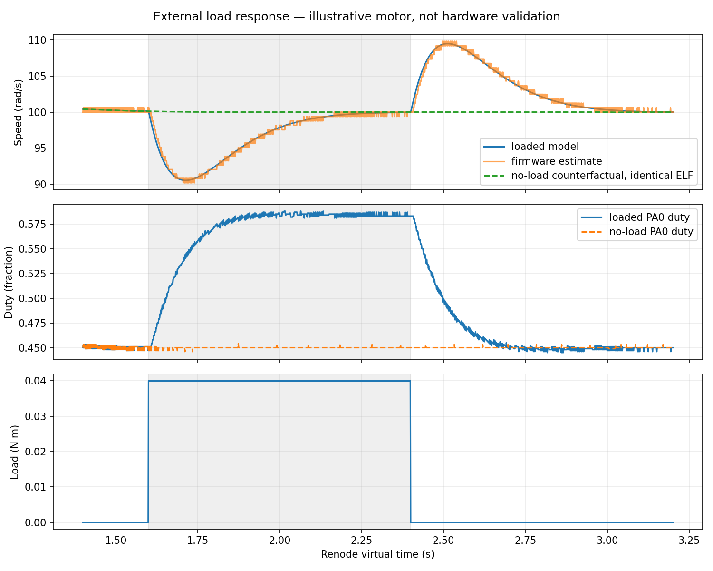

# One closed firmware–motor loop

This records the single-motor milestone, which remains runnable. The
subsequent [planar robot report](robot.md) adds two driven wheels using a
separate hardware profile and preserves this demonstration and its tests.

The headless demonstration now executes real STM32F407 firmware in Renode:
TIM4 ISR → PI controller → TIM2 PWM → averaged bridge/motor → quadrature
GPIO → TIM3 encoder count → firmware speed estimate. An external shaft load
changes both the measured encoder speed and firmware's PWM response.

This is an illustrative numerical demonstration, **not hardware validation**.
The [acceptance contract](motor-loop-contract.md) records parameters, units,
signs, initial conditions and thresholds chosen before controller tuning.
The initial analytically selected gains passed; no gain tuning or relaxed
thresholds were needed.

## Run and inspect

```sh
cd /workspace/EmbeddedSim
bash tests/closed_loop/check.sh
```

The command downloads/checks the previously pinned Renode/GCC tools when
needed, builds the firmware, runs pure-model checks and nine firmware
scenarios, exports CSV/PNG/JSON, then runs the existing **57 peripheral
checks plus ELF, virtual-time and GDB checks**. It completed with exit 0.
Every emulator invocation has a 240 s wall timeout; stages also have outer
timeouts. Numerical assertions use virtual time. Missing outputs, compiler
errors and failed assertions return nonzero; stale result manifests are removed.

Python plotting dependencies are pinned in `tests/closed_loop/requirements.txt`
(NumPy 2.3.5, Matplotlib 3.10.8). If missing, the command installs wheels into
`/workspace/tools/embedded-sim-python`, leaving the system environment alone.
First setup requires GitHub release assets and, if necessary, PyPI access.
The retained tool/dependency cache supports subsequent offline runs. No new
network destination or credentials were required here.

Generated files are in `tests/closed_loop/out/`:

- `closed.csv`, `open.csv`, `reverse.csv`, `antiwindup.csv`, `noload.csv`,
  `repeat.csv`, `pause.csv`, `half.csv`, `quarter.csv`: timestamped traces.
- `closed.png`, `open.png`, `load-response.png`: plots with units.
- `results.json`: results, exact compiler/runtime banner, ELF/source/CSV
  SHA-256 hashes and convergence metrics; per-scenario `.log`, `.resc`,
  `.repl`, `.elf` files make failures inspectable.
- `model.csv`: independent physical-model analytical/convergence evidence.

Curated [results](evidence/motor-loop.json) and plots are retained alongside
this report. The original repository work and peripheral patches were
preserved. No GUI, robot body, second motor or editor was added.



## Separation and observation paths

| File | Responsibility |
|---|---|
| `models/Motor.cs` | Emulator-independent SI motor ODE/RK4, quadrature quantizer and rolling PWM measurement. No Renode references. |
| `integration/renode/MotorLoop.cs` | Virtual-clock adapter; observes PA0, applies driver voltage/external torque, injects PA6/PA7, exports traces. |
| `firmware/motor/controller.c` | Compiled Arm firmware: realistic RCC/GPIO/timer initialization, count differences, speed window, PI, saturation/anti-windup, setpoint sequence. |
| `firmware/motor/link.ld` | Flash vectors/code, initialized data and zeroed BSS, telemetry separate from firmware state/stack. |
| `tests/closed_loop/` | Headless orchestration, independent model checks, predeclared assertions, plotting and reproducibility. |

The adapter reads firmware telemetry **only for logging**. Model voltage
depends exclusively on actual PA0 transitions/level. Model speed or desired
speed is never fed into firmware. Firmware reads only TIM3 counts and its
TIM4 tick; it knows nothing about the load schedule. The host's final CNT
read is an assertion oracle, not a feedback input. No integration code
writes TIM3 CNT. Firmware initializes CNT offsets 65530 and 2 solely to
exercise forward wrap and reverse underflow; subsequent counts come from pins.

The original qualified configuration is retained: HSI16, AHB÷1, APB1÷1,
APB2÷2; TIM2_CH1/PA0 AF1 at 1 kHz, TIM3 PA6/PA7 AF2 mode 3,
TIM4 IRQ30 at 1 ms. PWM uses PSC15/ARR999 with ARR/CCR preloading.
Source patches remain reproducible through `emulation/renode/prepare.py`
and the C# loader; the installed CPU emulator binary is unchanged.

## Physical and control assumptions

Illustrative parameters: R=2 Ω, L=5 mH, Ke=0.05 V/(rad/s), Kt=0.05 N m/A,
J=0.0002 kg m², b=0.0001 N m/(rad/s), supply=12 V. Positive current drives
positive shaft speed; positive signed external load subtracts shaft torque.
The normal initial state is zero current, speed and angle. The reverse test
applies an explicit external velocity impulse to −40 rad/s at 0.05 s, after
firmware initialization.

RK4 integrates `di/dt=(V−Ri−Ke*omega)/L`,
`domega/dt=(Kt*i−b*omega−load)/J`, `dtheta/dt=omega`.
The ideal synchronous forward bridge uses `V=12*duty`. **Zero duty shorts
the motor terminals (dynamic braking), not coasting**. Negative current is
allowed; the ideal supply can absorb regeneration. Exported current is the
averaged model current, with switching ripple omitted.

Duty is high time in a trailing **1 ms** window. The present level is included
even without new edges, so sustained low/high becomes 0/1 within one window.
Period is measured between fresh rising edges; `pwm_period_s=0` means no
currently valid periodic estimate (startup/constant level). After a long gap
it requires two fresh rises. The motor does not depend on a stale period.
Measurement adds at most 1 ms+h delay; firmware's CCR preload can add another
carrier period. No CCR register is read to manufacture a duty measurement.

The encoder has 256 electrical cycles/revolution, **1,024 x4 counts/revolution**.
Unbounded angle retains fractional position; every integer count transition
is emitted in Gray-code order. TIM3 itself handles the 16-bit modulo count.
Firmware uses signed modular count deltas (valid below 32768 edges/tick),
accumulates an independent signed total and estimates speed over 10 ms.
One count/window is approximately **0.614 rad/s**. At 60/100/200 rad/s the
window contains about 98/163/326 counts, comfortably resolving the 2% bands.

PI runs every 1 ms with Kp=0.006 duty/(rad/s), Ki=0.05 duty/rad. Duty is
saturated to [0,1] and rounded to 1000 timer levels. Conditional integration
blocks further windup when saturated but allows unwinding. A zero reference
explicitly sets zero drive and clears the integral; braking then slows the
shaft. The no-load maximum is 222.22 rad/s, so all positive targets, including
the 200 rad/s saturation diagnostic, are achievable.

## Causal virtual time

I inspected the pinned `Machine.ScheduleAction`, `LimitTimer` and
`BaseClockSource` implementation [1–3]. The adapter uses a periodic
`LimitTimer` on **the same machine ClockSource as MCU timers**, rather than
wall-clock threads or monitor polling. Timestamp sampling uses
`machine.ClockSource.CurrentValue`, avoiding CPU-observer timestamp jitter.

At each grid boundary T:

1. Advance the model from the previous boundary using **previously known**
   voltage/load. Future PWM or load values never affect the past interval.
2. Convert the new angle to all intervening A/B transitions and deliver them
   to PA6/PA7 **at T**, in order. Never label them with an earlier timestamp.
3. Measure the trailing PWM window and apply any externally scheduled load
   for the next interval. Sample ground truth/committed firmware telemetry.

This deliberately approximates continuous crossing times by a grid. For the
monotone motion segments exercised, each crossing is delayed by at most h;
no MCU rollback or retroactive injection is used. Multiple transitions at
one boundary retain their valid order; zero digital filtering is assumed.
The reverse diagnostic uses a deliberately coarse **250 us** grid and
observed two transitions in one callback through the actual GPIO/timer path.

Main coupling h=**25 us**, compared with 12.5 and 6.25 us. The runtime asserts
no step exceeds h+2 ns. The observed maximum equals the configured grid
apart from floating-point representation error (<1 ns). Electrical time
constant L/R=2.5 ms is 100 main physics steps; effective mechanical time
constant is approximately 148 ms.

CSV rows are sampled every 1 ms. Ground-truth columns belong to `time_s`;
firmware columns are the most recent committed ISR frame, identified by
`fw_tick`. A seqlock rejects partially written frames. The estimate has the
10 ms window's filtering delay plus up to one logging interval; it is not
presented as instantaneous ground truth. Pause/resume uses no physical wall
time: two read-only paused state samples match, and the resumed CSV exactly
matches an uninterrupted run.

## Actual results

All nine firmware scenarios and independent model checks passed, followed
by the unchanged 57/57 peripheral suite and original ELF/time/GDB checks.

| Check | Measured outcome |
|---|---|
| Analytical steady state at 6 V | No load: 111.111111 rad/s, 0.222222 A; load 0.04 N m: 81.481481 rad/s, 0.962963 A. Both agree with analytical equations well inside 1e−5 relative tolerance. |
| Independent RK4 convergence | Normalized transient errors at h=1/0.5/0.25 ms: 7.80e−11 / 4.86e−12 / 3.00e−13 against 15.625 us reference; >8× reduction each halving. Zero-voltage braking energy decreases. |
| Open loop | Actual measured 0→0.5→1→0 duty agrees within 0.002 after window delay; final braking speed <1 rad/s. Constant high/low, period reacquisition, and startup have explicit checks. |
| 60→100 rad/s steps | Worst steady true/estimated error across selected windows: **0.394% / 0.411%**, below 2%. True speed settles into the 2% band at 0.371 s and 1.132 s, inside the 0.6 s settling budget after each step. |
| Apply load at 1.6 s | Minimum speed **90.5404 rad/s**; measured duty rises **0.45021→0.58388**. True/estimated speeds return permanently to the 2% band by **2.009/2.017 s**. Loaded steady true error 0.152%. |
| Remove load at 2.4 s | Peak **109.5129 rad/s** (<15% overshoot); true/estimated band recovery by **2.808/2.817 s**. |
| Zero reference at 3.2 s | Drive becomes zero; speed decays to **0.42494 rad/s** at 4 s (<2 threshold), with negative braking current. |
| Causal counterfactual | Identical ELF SHA for loaded/no-load runs; traces identical before load. Afterwards true and firmware-estimated speed fall, and firmware-commanded duty rises >0.10 relative to no load. |
| Saturation/anti-windup | 35 full-duty samples on the feasible 200 rad/s step; max integral **0.90519**, below 0.95. The later 60 rad/s target settles within its 2% window. |
| Encoder conservation/wrap | Forward: +46358 generated counts, final actual CNT=46352 from offset65530. Reverse: −966, actual CNT=64572 from offset2; negative firmware estimates and multiple same-step pin transitions verified. All final counters match generated counts modulo65536. |
| Coupling convergence | 25 vs6.25 us: max/RMS speed difference **0.01346/0.002164 rad/s**. 12.5 vs6.25 us: **0.01078/0.001895 rad/s**. Both comfortably below 1/0.25 thresholds and improve with refinement. |
| Repeat/pause | Default, repeated and pause-at-1.8 s runs produce byte-identical complete CSV traces. |

The PI implementation and all setpoint commands execute as Arm instructions;
the load schedule is exclusively outside firmware. The load/no-load
counterfactual, pin-only feedback and equal-ELF check rule out replacing the
controller response with a host-scripted duty sequence.

## Limitations and next task

There is no blocker to this selected closed loop. Numerical consistency is
not physical validation: parameters are illustrative, the driver is averaged,
and current ripple, nonlinear friction, losses, voltage sag, temperature and
hardware encoder imperfections are omitted. Only forward commanded drive is
supported; reverse is passive backdrive. The zero-speed policy does not hold
a loaded shaft at rest.

The coupling is bounded, not an exact continuous-event root solver. Arbitrary
within-step direction reversals/excursions near an encoder threshold would
need additional subdivision/root detection before broader edge-accuracy
claims. Cross-platform bitwise determinism and restart/snapshot restoration
were not tested; pause/resume within one process was. The earlier qualified
STM32 scope still applies: no general HAL/SysTick/clock-tree or cycle-accuracy
claim is added.

Next, make motor/driver/encoder parameters a small explicit configuration and
add further plant and load cases (current limits, shaft reversals and supply
variation), retaining pin-level feedback, timing convergence and the existing
regressions. A GUI or robot editor remains unnecessary for that work.

References inspected (infrastructure revision
`066a7f13c052215632d469c995c89aea37c573b1`):

1. [Machine.ScheduleAction](https://github.com/renode/renode-infrastructure/blob/066a7f13c052215632d469c995c89aea37c573b1/src/Emulator/Main/Core/Machine.cs#L591)
2. [LimitTimer](https://github.com/renode/renode-infrastructure/blob/066a7f13c052215632d469c995c89aea37c573b1/src/Emulator/Main/Peripherals/Timers/LimitTimer.cs)
3. [BaseClockSource scheduling/update](https://github.com/renode/renode-infrastructure/blob/066a7f13c052215632d469c995c89aea37c573b1/src/Emulator/Main/Time/BaseClockSource.cs)
