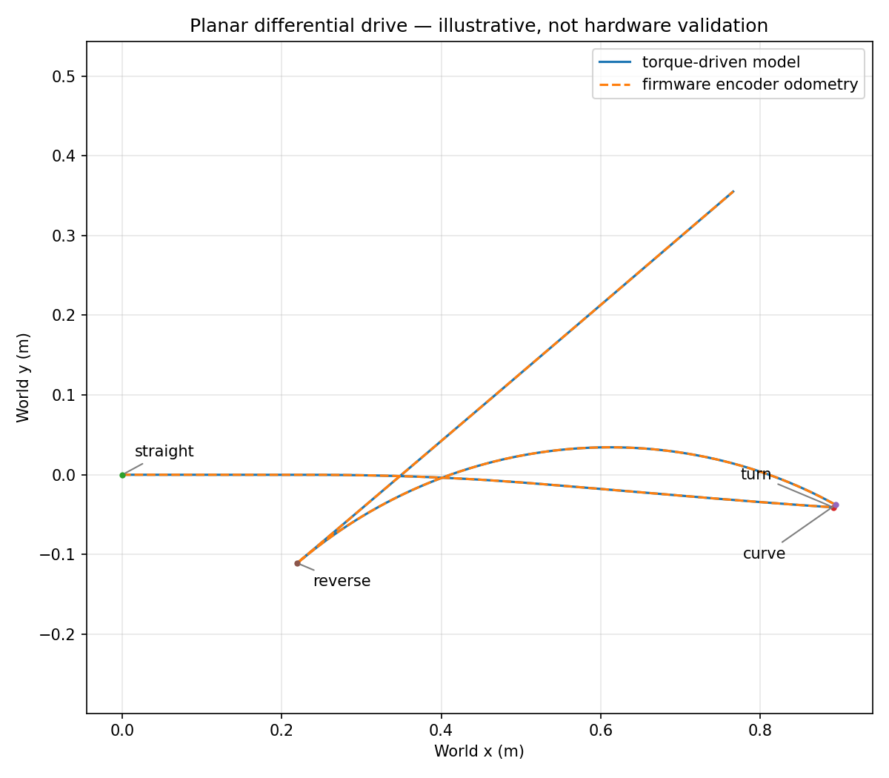
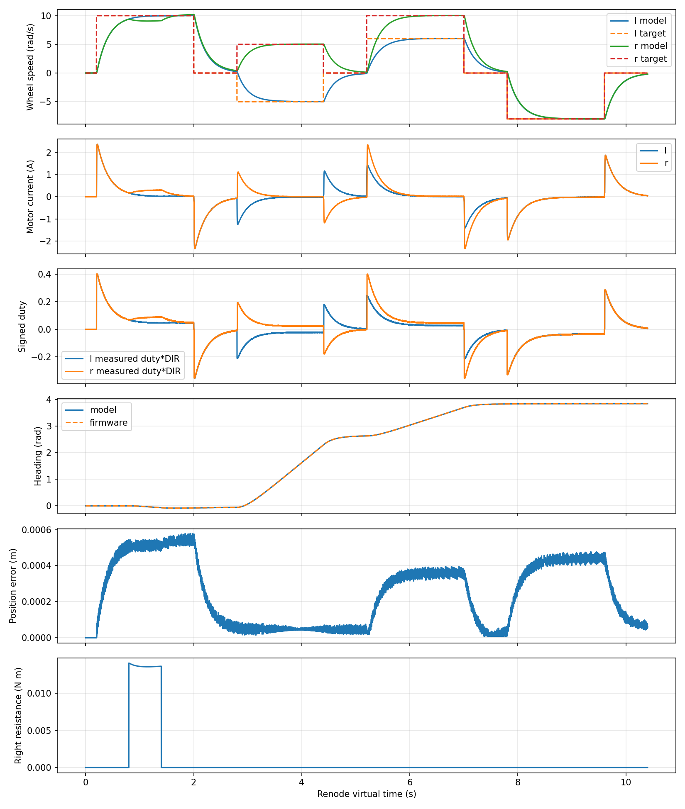

# Headless planar differential-drive robot

Two real firmware PI loops now drive a torque-based planar robot through
PWM/direction pins and receive independent GPIO quadrature feedback. Firmware
odometry is computed only from encoder increments. The simulator never sets
wheel speed from PWM or position from a firmware command.

The [pre-evaluation contract](robot-contract.md) fixes the illustrative
parameters, sequence and tolerances. The initial PI gains passed without
tuning or relaxed thresholds. This is model consistency, **not physical
hardware validation**.

## Reproduce and inspect

```sh
cd /workspace/EmbeddedSim
bash tests/robot/check.sh
```

This command completed with exit 0. It builds/runs the new hardware
qualification first, checks independent robot physics, runs six compiled-
firmware robot cases, exports traces/plots, then runs the existing complete
single-motor demonstration and peripheral/ELF/time/GDB checks. The original
single-motor command remains `bash tests/closed_loop/check.sh`.

The existing pinned Renode 1.17.0 portable binary (.NET 8.0.12) and xPack GNU
Arm GCC 15.2.1 are reused. Firmware uses Cortex-M4 Thumb/soft float and the
existing linker/startup conventions; newlib's sinf/cosf supply firmware
odometry math. No compiler, CPU emulator or manual binary patch was added.
Source patches are unchanged. The only shared model changes expose the
existing motor electrical derivative/torque and parameterize encoder
resolution while retaining the old default1024 counts/revolution.

Cached setup works offline. First setup may download existing pinned tools
from GitHub releases and NumPy 2.3.5/Matplotlib 3.10.8 wheels from PyPI. Scripts
retain TLS/checksum verification and install locally under `/workspace/tools`.
Emulator invocations have 300 s wall timeouts; outer stages also have
timeouts. Assertions, compiler/Monitor failures, model warnings and missing
outputs return nonzero.

Generated artifacts in `tests/robot/out/`:

- `main.csv`: 10400 timestamped samples; `repeat.csv`, `pause.csv`,
  `half.csv`, `quarter.csv`, `noload.csv` support comparison/replay.
- `trajectory.png`, `timeseries.png`: standalone plots with SI units.
- `physics.csv`: independent force, geometry and energy results.
- `qualification.json`, `qualify.log`: named compiled-firmware path checks.
- `results.json`: hashes, per-case metrics, timing/convergence and source
  provenance; corresponding `.elf`, `.repl`, `.resc`, `.warnings.log`, `.log`.
- `check.log`: retained transcript of the combined verified command.

Curated [results](evidence/robot-results.json),
[hardware qualification](evidence/robot-qualification.json) and plots are
retained here. Traces include ground-truth/firmware x/y/yaw, both actual and
estimated wheel speeds, currents, measured duties, direction levels, voltages,
encoder/generated/firmware counts, external resistance, energy and work.
Ground-truth and firmware columns are explicitly separate.



## Exact hardware profile

STM32F407VGT6; HSI16, AHB÷1, APB1÷1, APB2÷2. Flash 1 MiB, main SRAM 128 KiB,
CCM 64 KiB. New profile: `emulation/renode/stm32f407vg-robot.repl`.
The original single-motor platform is left intact.

| Function | Left | Right |
|---|---|---|
| PWM, active-high PWM1 | TIM2_CH1 → PA0 AF1 | TIM2_CH2 → PA1 AF1 |
| Encoder, mode3 x4, direct TI1/TI2 | TIM3_CH1/2 ← PA6/PA7 AF2 | TIM4_CH1/2 ← PB6/PB7 AF2 |
| Direction, push-pull GPIO output | PA4 | PA5 |

Both PWM channels share PSC15/ARR999 and a 1 kHz carrier, with independent
preloaded CCRs. TIM3/4 use ARR65535 and no input filters. Control uses
**TIM2 update IRQ28 at 1 ms**, freeing TIM4 for the second encoder. It is
intentionally tied to the PWM time base; changing PSC/ARR would require
changing/requalifying the controller timestep. GPIOA/B clocks are enabled
with normal firmware RCC writes/readback. No pins conflict in this profile.

I inspected the current STM32_Timer/RCC/GPIO implementation and the pinned
F4 platform's PA1/TIM2 and PB6/PB7/TIM4 mappings [1]. Support was not inferred
from the chip/board name. Before robot runs, `firmware/robot/qualify.c`
passed **22/22** checks: both period/high-time measurements (2.1 ns tolerance),
independent CCR updates/0%/100%, PA1 AF disconnect/restore, independent
encoder directions/wrap, TIM4 CEN/clock gating, PB6/7 mode/AF gating,
all four PA4/5 BSRR level combinations, and TIM2 interrupt delivery,
flag clearing and continued operation. The stimulus writes only a RAM
mailbox; actual MCU instructions configure the peripherals.

This qualifies the listed GPIO output paths; it does not add a general
GPIO clock-gating or arbitrary remux-while-high model.

## Direction/bridge contract

| PWM duty | DIR | Ideal averaged terminal voltage |
|---:|---:|---:|
| 0 | either | 0 V, synchronous short-circuit braking |
| d>0 | 1 | +12d V, positive wheel torque for positive current |
| d>0 | 0 | −12d V |
| direction transition | changes | 0 V for 2 ms, current remains continuous |

Firmware waits 3 ticks at zero PWM before changing DIR, then 3 more before
allowing nonzero PWM. The bridge separately detects nonzero-duty direction
requests and applies its inhibit interval. A deliberate unsafe pure-driver
test is detected/blanked; the robot run has **zero unsafe requests**.
Negative current and regeneration are allowed. The supply is ideal and can
absorb energy. This is logical reversal protection, not transistor/current-
limit or physical electrical-safety validation.

Both PWM duties come only from timestamped pin transitions/current levels
using the existing trailing1 ms window. Each wheel has its own bridge,
PWM history, current, angle and encoder phase. No CCR, desired speed or
ground-truth state substitutes for an observed pin signal.

## Coupled dynamics and inertia accounting

World/body axes initially coincide: x forward, y left, yaw positive CCW.
The left wheel is at body y=+b/2, right at y=−b/2. Both wheel coordinates
are normalized so positive rotation rolls forward (motor wiring follows
that convention). Direct drive means rotor speed equals wheel speed.

Illustrative values: m=2 kg, Iz=0.04 kg m², r=0.05 m, b=0.30 m.
Each local axial inertia is j=Motor.J+Jwheel=0.00025 kg m². Motor electrical
and friction parameters remain R=2 Ω, L=5 mH, Ke=Kt=0.05 in coherent SI,
B=0.0001 N m/(rad/s). Flat ground, rigid chassis, axle-centred COM and
ideal passive support enforce rolling without longitudinal/lateral slip.

Rolling constraints give

```text
v = r/2 (wL+wR)                yawRate = r/b (wR-wL)
xdot = v cos(yaw)              ydot = v sin(yaw)
```

These use **dynamically integrated wheel speeds**, not firmware references.
Let tau_i=Kt*i_i, drag_i=(B+c_i)*w_i and F_i be longitudinal ground force.
The wheel/body equations are

```text
j*alpha_i = tau_i - drag_i - r*F_i
m*vdot = FL+FR                Iz*yawAcceleration = b/2*(FR-FL)
```

The ideal lateral constraint supplies the centripetal reaction
`F_lateral=m*v*yawRate`. Body lateral velocity is zero, so this reaction
does no work. With the COM on the axle it adds no omitted forward/yaw
inertial term; an off-axle COM would require a different model.

Eliminating forces produces

```text
[a c] [alphaL] = [tauL-dragL]
[c a] [alphaR]   [tauR-dragR]
a = j + m*r²/4 + Iz*r²/b² = 0.0026111111 kg m²
c =     m*r²/4 - Iz*r²/b² = 0.0001388889 kg m²
di_i/dt = Motor.CurrentRate(i_i,w_i,V_i)
```

The matrix is positive definite: a+c=0.00275 and a−c=0.0024722222 kg m².
Its off-diagonal term physically couples the wheels. Two isolated motor
`Step` calls followed by prescribed chassis motion would miss this reaction
load. The implementation instead jointly integrates both electrical states,
wheel speeds/angles and chassis pose with RK4, reusing the motor equations.

m includes wheel/motor **translational mass**. Iz includes the assemblies'
**yaw** inertia about the chassis COM, including their offsets. Their local
axial spin is counted only in j. Gravity/support reactions do no planar
work; ideal lateral constraint forces enforce zero lateral slip and do no
work. Motor axial inertia is not added again after using this matrix.

The independent energy audit uses

```text
E = L/2*(iL²+iR²) + j/2*(wL²+wR²) + m/2*v² + Iz/2*yawRate²
dE/dt = VL*iL + VR*iR - R*(iL²+iR²)
        - B*(wL²+wR²) - cL*wL² - cR*wR²
```

Electrical work and each loss integral are included as additional RK4
states. External viscous resistance does known negative work. Forces
reconstructed independently from wheel torque/inertia satisfy body force
and yaw torque equations. This checks signs/units and double-counting,
not whether the illustrative parameters match a physical robot.

## Firmware, odometry and time

`firmware/robot/controller.c` reads only two encoder counters and its timer
tick. It runs independent signed PI loops with saturation/conditional
anti-windup, Kp=.04 and Ki=.02, plus the reversal state machines. Each
encoder has 1024 electrical cycles/4096 x4 counts per shaft revolution.
The 20 ms count window resolves 0.0767 rad/s per count. Signed modular deltas
handle 16-bit counter wrap; cumulative positions use separate signed totals.

Odometry uses dl=r*2pi*dcountL/4096, dr likewise, ds=(dl+dr)/2,
dYaw=(dr−dl)/b and midpoint-heading integration. Firmware yaw wraps into
[-pi,pi); simulator yaw is unwrapped. Plot overlays unwrap firmware yaw;
error tests use wrapped angle differences. Radius/track are assumed known.

The repeatable sequence is straight 10/10, stop, in-place −5/+5, stop,
curve 6/10, stop, reverse −8/−8, stop (rad/s); exact times are in the contract.
An external right viscous coefficient 0.0015 N m/(rad/s) is applied on
[0.8,1.4) s. It acts on actual wheel speed; firmware has no load input.
Loaded/no-load runs use identical ELF hashes and are identical before 0.8 s.

The established causal clock-source loop is retained: advance physical
state with previously known voltage/resistance, emit each wheel's A/B
transitions at the current boundary, then acquire new inputs for the next
interval. Main h=25 us, compared with 12.5/6.25 us; no retroactive timestamps
or wall-clock physics steps. Encoder transitions are quantized to the
boundary; no sub-grid continuous crossing solver is claimed.

Longer robot runs exposed a **logging**, not plant/control, defect in the
initial implementation: floating sample-time accumulation could shift the
sample phase, and a seqlock reader could repeatedly encounter a long ISR.
Robot trace scheduling now uses integer nanoseconds. Firmware publishes an
inactive RAM frame bank with one atomic index store; the observer always
reads a complete frame. No ground truth enters either RAM bank. Actual
observation age was at most 1 ms. Pose-error limits include this age as well
as encoder quantization and odometry discretization, rather than demanding
perfect simultaneous odometry.

## Actual verification results

The combined command passed: 22 hardware checks, independent dynamics tests,
six robot runs, all nine existing single-motor cases and model checks,
57/57 original peripheral checks, and original ELF/time/GDB checks.

| Check | Actual result |
|---|---|
| Symmetry/geometry | Equal voltage straight; opposite voltage in-place; equal negative voltage reverse; mirrored left/right trajectories agree to 1e−10. Unequal-voltage steady curvature and arc chord meet 0.1% tolerance. |
| Force/energy | Force/yaw residuals at numerical roundoff; pure-model energy residual <7e−10 J. Unforced braking energy decreases; forced tests account for electrical work and external resistance. Main trace max energy-balance residual2.81e−11 J. |
| Wheel control | Worst settled mean speed error **1.16%**, below 5%. All four stop windows satisfy |w|<0.5 rad/s; signed outputs stay bounded. No IRQ errors or unsafe direction requests. Initial gains retained. |
| Odometry | Max current-ground-truth versus latest firmware-frame position error **0.579 mm**, wrapped heading error **0.001911 rad**, below 2 cm/0.02 rad. Final ground truth(0.766060,0.355052) m, yaw3.851183 rad; firmware(0.765999,0.355050) m, wrapped yaw−2.431830 rad. |
| Added right resistance | Relative to identical-ELF no-load run, right current rises **0.256 A**, right duty rises **0.03924**, and right speed drops **0.597 rad/s** in the declared comparison windows. Firmware estimate also shows the dip. |
| Timing/counts | No physics step exceeds configured h+2 ns; both final actual timer counts equal their generated totals plus initial offsets modulo 65536. Independent encoder feedback retained. |
| Refinement25→6.25 us | Max position/yaw/wheel-speed difference **55.8 µm / 8.23e−5 rad / 0.00420 rad/s**. |
| Refinement12.5→6.25 us | **9.89 µm / 1.99e−5 rad / 0.00218 rad/s**; all improve and meet preset 5 mm/0.01 rad/0.5 rad/s limits. |
| Repeat/pause | Main, repeated and pause-at-3.6 s runs have byte-identical 10400-row CSV traces. Paused state samples also match. |



## Model limitations

The selected planar loop has no required blocker. It assumes perfect rolling,
an axle-centred rigid body and ideal passive support. There are no collision,
traction/tyre limits, terrain, detailed caster/gyro, battery, thermal, current-
limit or switching-level models. Direction blanking is numerical/logical
protection. No physical validation or MCU cycle accuracy is claimed.
Counter-delta logic assumes fewer than 32768 edges per control tick.

Time coupling is a bounded discrete model, not exact continuous-event root
finding; arbitrary within-step wheel reversals near a threshold could need
subdivision/root detection for stronger edge-timing claims. Tests cover the
specified trajectories at the three resolutions. Cross-platform bitwise
identity and process-restart snapshots remain untested. The earlier limited
STM32 peripheral scope still applies outside this newly qualified profile.

Use the [recorded replay viewer](../viewer/README.md) to inspect the
trajectory, firmware odometry, and recorded signals in a browser.

[1] [Pinned F4 platform mappings](https://github.com/renode/renode/blob/ab721d88e135a1bcb8ed2ecc5a38f51cbe61fdd2/platforms/cpus/stm32f4.repl),
with the existing [peripheral qualification](peripheral-qualification.md)
and [motor timing report](motor-loop.md) as the reused implementation basis.
